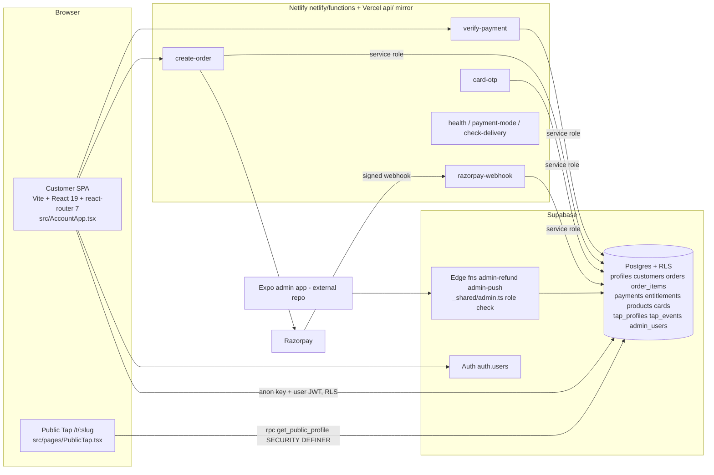

# AAROH current-state handoff (assessment of 2026-10-13/14)

Read-only assessment. Nothing was committed, migrated, deployed or changed in any project. No secret values were read or are reproduced here (`.env` exists in the AAROH worktree and was not opened). Companion files: `AAROH_IMPLEMENTATION_STATUS.md`, `AAROH_RISK_REGISTER.md`, `AAROH_NEXT_STEPS.md`.

Evidence labels: **[RAN]** I ran it on 2026-10-13 (Node v20.18.0, offline local stack). **[READ]** I read the file. **[REPORTED]** stated in the repo's own reports and not re-verified by me.

## 1. Where the project actually is

| Location | Branch @ commit | State | Role |
|---|---|---|---|
| `shygon tech/shygon-tap-v5-web-aaroh` | `v6/aaroh-store` @ `6d00f2f` | **40 uncommitted entries** (27 modified, 13 untracked). Being edited by another session: `src/data/aaroh.ts` changed 2026-10-13 21:57 | **The main AAROH implementation** |
| `shygon-tap-v5-web-v6` | `v6/stage-6-rc` @ `6d00f2f` | clean | V6 release candidate (the base AAROH branched from) |
| `shygon-tap-v5-web` (main checkout) | `opencode/m0.3-handover` @ `94cbafe` | 9 uncommitted | M0.3 handover |
| `…-m03`, `…-commerce`, `…-upgrade-fix`, `…-website` | `feat/m0.3-security-identity` `5659d15`; `feat/commerce-c5-seo` `93ae352`; `fix/upgraded-zip` `71e79ec`; `feat/website-experience-upgrade` `8becea3` (+4 uncommitted) | parallel/parked | Not the AAROH baseline |
| **This worktree** `.claude/worktrees/shygon-aaroh-handoff-09c0b3` | `claude/shygon-aaroh-handoff-09c0b3` @ `8becea3` | bare V5 import | **Contains no AAROH code.** Only these four reports were added |
| `shygon-tap-v5-admin` | not a git repo | Expo admin app; its readiness doc is dated 2026-09-04 and describes a pre-migration database | Separate; treat as stale |

Four other `.claude/worktrees/*` exist, all at bare V5 `8becea3`. No git remote is configured (B-4); CI has never run remotely [REPORTED].

**SHYGON OS** has no separate implementation. It is a planning pack (`docs/shygon-os/00…14`, M0/M1 documents) plus governance. The M0.3 work (migrations 020/021) is security/identity hardening of the same Supabase database, delivered inside this repo. Education Intelligence is not in the code.

**Governing documents** (in the AAROH worktree): `docs/v6/*` (stage 1–6 reports, `backlog.md`, `readiness-report.md`), `docs/release/*`, `docs/governance/decisions/DEC-2026-035` (V6 scope) and `-036` (AAROH store), `DESIGN.md`, `design-assets/manufacturing-handoff.md`, `../shygon-v6-tracker.md`.

## 2. Product, as implemented

One store product family, **SHYGON Version 1 — AAROH**: a physical NFC card, a QR fallback and the browser-based SHYGON profile (no app). Editions are visual variations of one platform (`src/data/aaroh.ts`, DEC-2026-036 Q3 "visual only"). Business/student/event/hotel are described as use cases, not products. Privé is absent. **Physical card sales are gated closed** (`VITE_CARD_SALES_ENABLED` in the UI, `CARD_SALES_ENABLED` in `netlify/functions/create-order.mjs:396`). The V6 RC is "digital-first": the digital experiences (Business ₹299 etc.) are what can be bought today.

## 3. Architecture

- **Frontend:** two route trees. `src/App.tsx` serves public Taps (`/t/:username`, `/tap/:username`); `src/AccountApp.tsx` serves the store, auth and the signed-in pages (`/shygontap/*`, protected via `ProtectedRoute`). Every public page is prerendered by a build plugin (`vite.config.ts`, `src/seo/*`). The services layer is `src/services/*` (catalog, orders, payments, tap, cards, entitlements, analytics, privacy, support, notifications).
- **Backend:** serverless functions only, in `netlify/functions/*` and mirrored for Vercel in `api/*`; shared logic in `netlify/lib/` (`fulfilment.mjs`, `razorpay.mjs`, `sms.mjs`, `log.mjs`, `supabase.mjs`). Two Supabase Edge Functions for admin (`supabase/functions/admin-refund`, `admin-push`).
- **Supabase:** browser uses the anon key plus the user's JWT under RLS; functions use the service role. Migrations `supabase/migrations/001…027`; since DEC-2026-023 the test suites start from a captured live baseline (`supabase/baseline/`) and apply **020 onward only**. `supabase/APPLY_ALL.sql` bundles 020+ for manual application in the SQL editor (never `db:push`).
- **Identity model:** `auth.users.id` (U) is the user id stored in `orders.user_id`, `entitlements.user_id`, `tap_profiles.user_id`. `customers.id` (C) is a separate random UUID created by `handle_new_user`; `profiles.customer_id` and `tap_profiles.customer_id` are NOT NULL FKs to C. V5 wrote U into those columns (I-1/I-2/I-3: first-time buyers' fulfilment failed with FK 23503). Migration 021 adds `customer_id_for(uuid)` and a `resolve_customer_id` trigger that maps U→C in the database. **`netlify/lib/fulfilment.mjs:410` still writes `customer_id: userId`**, so the code depends on 021 being applied. 021 is not applied to production (below).
- **Admin authorization:** `admin_users` (`user_id`, `role`, `is_active`, `permissions[]`). `supabase/functions/_shared/admin.ts` looks up the row and checks a role→permission map (owner, admin, fulfilment, support, viewer) that mirrors `admin_role_permissions()` in migration 003. `test:admin-edge` proves the edge map equals the database for every role×permission pair (30 pairs) and that editing one's own metadata gains nothing [RAN]. There is **no admin UI in this repo**.
- **Public tap resolution:** `/t/<slug>` → `get_public_profile(slug)` (SECURITY DEFINER, field allowlist; hidden phone/email absent; six states: active, paused/draft, suspended, expired, not found, hostile slug). `record_tap_event` is salted-daily-hash, 10 s dedupe, 60/hour cap (migration 025). Tap URLs are built from `SITE_URL` (`src/lib/site.ts`, default `https://shygontech.com`), deliberately not from the browser origin, because a printed card cannot be reissued.
- **Order → payment → fulfilment:** `create-order` prices server-side from `products` (refuses forged amounts, delisted/unknown SKUs, invented finishes), creates the Razorpay order; `verify-payment` (HMAC `order|payment`, constant-time) and `razorpay-webhook` (HMAC, `timingSafeEqual`, event-id dedupe table) both call `fulfilOrder` in `netlify/lib/fulfilment.mjs`, which is idempotent and grants entitlements (`grantEntitlement`, upsert on `user_id,type,key`) and provisions a draft Tap (`provision_tap_on_payment`, migration 021; Taps only after payment, migration 023).
- **Hosting:** two deploy targets are configured (`netlify.toml`, `vercel.json`; the build/test checks they serve identical security headers). Apex `shygontech.com` canonical, `www` redirected. Netlify is pinned to Node 22 because supabase-js needs a native WebSocket. Nothing from V6 is deployed anywhere [REPORTED]. DNS, SSL and the domain are owner actions I could not inspect.

## 4. Environment variable names (values not read)

Browser (public by design): `VITE_SUPABASE_URL`, `VITE_SUPABASE_ANON_KEY`, `VITE_RAZORPAY_KEY_ID`, `VITE_CARD_SALES_ENABLED`, optional `VITE_SITE_URL`. Server: `SUPABASE_URL`, `SUPABASE_SERVICE_ROLE_KEY`, `RAZORPAY_KEY_ID`, `RAZORPAY_KEY_SECRET`, `RAZORPAY_WEBHOOK_SECRET`, `CARD_SALES_ENABLED`, `ALLOW_LIVE_PAYMENTS_LOCALLY`, `OTP_SECRET`, `OTP_DEV_MODE`, `SMS_PROVIDER` (`msg91`|`twilio`), `MSG91_AUTH_KEY`, `MSG91_TEMPLATE_ID`, `MSG91_OTP_VAR`, `MSG91_ORDER_TEMPLATE_ID`, `MSG91_ORDER_VAR`, `MSG91_AMOUNT_VAR`, `TWILIO_ACCOUNT_SID`, `TWILIO_AUTH_TOKEN`, `TWILIO_FROM`, `TWILIO_MESSAGING_SERVICE_SID`. Supabase Edge secrets: `RAZORPAY_KEY_ID`, `RAZORPAY_KEY_SECRET`. Source: `.env.example`.

## 5. Design system

- **Logo:** use `public/brand/shygon-logo.svg`, `shygon-logo-on-black.svg`, `shygon-mark.svg` (ribbon S, 428×798), `shygon-wordmark.svg`, `public/logo.png`. `DESIGN.md` forbids redrawing or recolouring beyond one foil colour.
- **Type and colour:** Geist and Inter via `@fontsource` (`src/index.css`); AAROH tokens in `src/styles/aaroh.css` (`--aaroh-gold` from `--shygon-metal #c9b486`, dark stage gradient, 26 px radius). Storefront theme CSS is the theme (see memory note on `:root`/layer/`!important` traps).
- **Cards:** two sets of designs exist and **contradict each other**:
  - *Implemented in the store:* Heritage Geometry, Obsidian, Aureate, each Standard and Premium, front and back, as portrait webp (`public/assets/aaroh/*`, 960×1522 and 480×761), generated by `design-assets/src/editions.mjs`.
  - *Specified in `DESIGN.md` round 2 and drawn as concepts:* Signature Noir, Ivory Atelier, Midnight Titanium (`design-assets/concepts/*`, `renders/aaroh-*-concept.png`), plus a **proposed** AAROH lotus emblem (needs owner approval and trademark clearance, O-A4) and manufacturing notes (foil border must not form a closed loop). Every dimension and process is "PROPOSED – REQUIRES VALIDATION"; no manufacturer test is claimed.
  - Old copy in `src/data/shygonTapData.ts:395,406,427` still names Noir/Ivory/Titanium.
- **Not read by me:** `SHYGON AAROH Design System.pdf`, the moodboard PNGs and the 10-edition design canvas artifact referenced in memory. Gaps recorded by the repo: no light profile palette for Ivory, `titanium` profile theme is only proposed (DEC-036 O-A1).

## 6. NFC and security claims

`design-assets/manufacturing-handoff.md:14` leaves the chip open: "NTAG 213/215/216 class, or equivalent with an originality signature, preferred". **The chip model is not decided.** A plain NTAG213 tag is a static NDEF URL and can be copied; no product copy I grepped claims clone-proofing, and none should until a chip with cryptographic authentication (for example a rolling-counter/SUN-capable Type 4 chip) is chosen **and** the server verifies it. No such verification exists in the code today (card activation is by SMS OTP, `netlify/functions/card-otp.mjs`, migration 015). The QR fallback encodes the same canonical Tap URL.

## 7. Test evidence (my run)

See `AAROH_IMPLEMENTATION_STATUS.md` §Tests for the table. Headline: lint passes; **`tsc -b` and `npm run build` fail with 12 type errors in the uncommitted tree**, so the passing bundle/SEO/secret checks ran against a stale `dist/` from 2026-10-12; `test:aaroh` (6 pass, 7 fail) and the admin-contract step of `test:db` fail because migration 027 was rewritten under DEC-2026-037 (an unwritten decision) while the tests and DEC-2026-036 still describe the earlier version. Everything on the V6 RC's identity, RLS, payment, public-Tap, edge-auth and observability suites passes locally.

## 8. Files and access the other assistant needs

**Files:** a snapshot (not a live link) of the AAROH worktree after the other session finishes; `docs/v6/readiness-report.md`, `docs/v6/backlog.md`, `docs/v6/stage-3..6-report.md`, `docs/release/*`, DEC-2026-035/036, `DESIGN.md`, `design-assets/manufacturing-handoff.md`, `src/data/aaroh.ts`, `aarohProduct.ts`, `supabase/migrations/020…027`, `supabase/baseline/`, `netlify/lib/fulfilment.mjs`, `netlify/functions/*`, `supabase/functions/_shared/admin.ts`, `netlify.toml`, `vercel.json`, `.env.example` (names only), `AAROH Design System.pdf` and the moodboard. **Do not share** `.env`, any zip in the parent folder (earlier archives are the suspected credential-exposure vector, DEC-2026-001) or customer data.
**Access:** read-only Supabase SQL (the VERIFY ON LIVE queries in the migration headers) is a human step; Razorpay test-mode dashboard; no production write access.

## 9. Questions only the owner can answer

1. **Edition set:** which designs are the launch designs: Heritage Geometry / Obsidian / Aureate (code, migration 027, public images) or Signature Noir / Ivory Atelier / Midnight Titanium (`DESIGN.md`)?
2. **DEC-2026-037** is cited by code and by migration 027 but no file exists. Is "V5 and AAROH sold side by side, AAROH ₹999 / ₹1,499, card checkout opens with `CARD_SALES_ENABLED`" approved, and does it supersede the "keep sales gated" answer (DEC-036 Q1) and D-10 (digital-first)? Both statements are currently live in different files.
3. NFC chip model and whether authenticated (clone-resistant) tags are a launch requirement.
4. Is the lotus emblem adopted? Trademark search owner?
5. Card release rules still deferred: expiry, loss, replacement, who may suspend (DEC-2026-035 D-5; V6-003/011/019/034/035).
6. Single deploy target (Netlify or Vercel), error-tracking provider, email channel, account-deletion policy (D-12), D-7 (history secret-scan finding), D-8 (admin UI), D-11, V6-093, V6-096.
7. Counted card stock (migration 027 inserts stock 0).
8. Who owns the other session editing the AAROH worktree right now, and which tree is the source of truth?
