# 02 — SHYGON OS Target Architecture

*Covers requested docs: 2 Target Architecture · 3 System Architecture Diagram · 9 Customer/Organization/Admin Architecture · 5 Multi-Tenant Architecture (overview; detail in 03/04).*

## 1. Guiding decisions

1. **Modular monolith on the existing stack.** Postgres (Supabase) remains the system of record and the policy enforcement point. Add *one* new server component — an **edge resolver/gateway** — and reuse Netlify/Vercel functions and Supabase Edge Functions. No microservices, no Kafka, no new database, no GraphQL. (Rule 4: no unnecessary technologies.)
2. **The Tap is a trigger, never a credential.** A tap yields an *identifier + a trust level*; the platform decides what happens (`TAP → IDENTITY → CONTEXT → PERMISSION → ACTION → SERVICE`).
3. **Policy lives in the database and in one evaluator.** RLS for tenant data; a single `evaluate_access()` decision function for anything beyond "read a public page"; every decision on sensitive resources is logged.
4. **Extend, don't fork.** `tap_profiles` → persona; `cards` → tap_devices; `entitlements` → subject-scoped; `admin_audit_log` → unified audit; `notifications` → delivery-tracked. Names of stored objects that admin RPCs depend on do not change.
5. **Public data path is separate from private data path.** Public/anonymous flows go through the edge resolver returning *pre-shaped, whitelisted JSON*. Private flows use RLS + JWT. They never share endpoints.
6. **Privacy defaults closed.** New fields default to PRIVATE; publishing a field is an explicit act per persona.

## 2. System architecture (logical)

```mermaid
flowchart TB
  subgraph Physical["Physical world"]
    NFC["NFC card / tag / badge / hotel device / label"]
    QR["QR (fallback, same device code)"]
  end

  subgraph Edge["Edge layer (Netlify/Vercel functions + CDN/WAF)"]
    RES["Resolver  GET /d/{code}, /t/{slug}<br/>trust level · rate limit · bot check · cache"]
    APIPUB["Public API  /api/v1/public/*<br/>(rescue relay, connect request, verify page)"]
  end

  subgraph Apps["Web apps (one Vite repo, lazy bundles)"]
    PUB["Public Tap renderer<br/>(existing, tiny bundle)"]
    CUST["SHYGON Customer  /app"]
    ORG["SHYGON Organization  /org"]
    DEV["Developer portal  /developers (later)"]
  end
  ADM["SHYGON Admin (existing APK; web admin later)"]

  subgraph Core["Core services (Supabase Postgres = policy point)"]
    ID["ID & Personas<br/>profiles · tap_profiles · contact_methods"]
    DEVS["Tap Devices & Routing<br/>cards(+) · tap_routes · lifecycle"]
    PRIV["Privacy & Consent<br/>field visibility · consent_grants"]
    AUTHZ["Authorization<br/>org RLS helpers · evaluate_access() · access_policies"]
    VER["Verify<br/>credentials · verification_records"]
    CON["Connect"]
    RESC["Rescue<br/>items · threads · relay"]
    LOC["Locations & Events (+content, i18n)"]
    COM["Commerce<br/>orders · payments · plans · subscriptions · entitlements"]
    NOTI["Notifications<br/>outbox · deliveries · preferences"]
    ANA["Analytics<br/>events · rollups"]
    AUD["Audit log (append-only)"]
  end

  subgraph Ext["External"]
    RZP["Razorpay"]
    SMS["MSG91 / Twilio"]
    MAIL["Transactional email"]
    PUSH["Push (Expo/FCM)"]
    SHIP["Shiprocket"]
    INTEG["School/PMS/CRM (Phase 5+)"]
  end

  NFC --> RES
  QR --> RES
  RES --> PUB
  RES --> DEVS
  PUB --> APIPUB
  APIPUB --> RESC & CON & VER
  CUST --> ID & PRIV & CON & RESC & COM & NOTI & ANA
  ORG --> AUTHZ & LOC & VER & COM & ANA
  ADM --> AUD & COM & DEVS & RESC
  DEVS --> AUTHZ
  AUTHZ --> AUD
  COM <--> RZP
  NOTI --> SMS & MAIL & PUSH
  COM --> SHIP
  AUTHZ --> INTEG
```



ASCII fallback of the tap path (for tools that don't render Mermaid):

```
 tap/scan ─▶ EDGE RESOLVER ──▶ device? ─▶ lifecycle state ─▶ tap_routes ─▶ target
              (rate limit,       │           (active? lost?     (persona | rescue_item |
               bot check,        │            suspended?)        location | event | org page)
               trust level)      ▼                                       │
                           tap_events (aggregate)                        ▼
                                                        visibility filter (audience = anonymous)
                                                                         │
                                                        pre-shaped public JSON ─▶ renderer
   escalations (never on the tap alone):  Connect ▸ consent   Rescue ▸ relay   Access ▸ evaluate_access() + step-up
```

## 3. The request lifecycle after a Tap (the core platform loop)

| Step | What happens | Where | Notes |
|---|---|---|---|
| 1 Tap | Chip/QR opens `https://shygontech.com/d/{code}` (new) or `/t/{slug}` (legacy printed cards). | Physical | Static URL for MVP; optional signed URL (NTAG 424 DNA SDM) later. |
| 2 Identify | Resolver maps code → `tap_devices` row (or slug → persona). Computes **trust level**: `T0 static-or-QR`, `T1 authenticated-tap` (SDM CMAC valid, counter fresh). | Edge | Never an identity claim. |
| 3 Lifecycle gate | Device state must be `active` (or `lost` → rescue route). `suspended/deactivated/retired` → neutral "unavailable" page. | DB | Fixes F3. |
| 4 Context | `tap_routes` picks target by rule (default persona; event mode active window; org override; lost mode). | DB | Deterministic, priority-ordered, all server-side. |
| 5 Audience | Viewer is `anonymous` (default) or an authenticated user; permission computed. | DB/Edge | Anonymous ⇒ PUBLIC fields only. |
| 6 Render | Pre-shaped JSON (`get_public_profile` v1 shape kept for personas). | Edge→client | No `user_id`, no private fields. |
| 7 Action | Optional escalations: **Connect** (consent), **Rescue** (relay), **Verify** (credential check), **Access** (policy + step-up). | APIs | Each has its own rate limits & audit. |
| 8 Record | Aggregate analytics event; audit for sensitive actions. | DB | No IP/UA stored raw. |

## 4. Product experiences (SaaS surfaces)

Four separate application experiences, sharing a component library and data layer but **not** a dashboard.

| Experience | Who | URL | Auth | Data boundary |
|---|---|---|---|---|
| **SHYGON Customer** | Individuals (student, professional, business owner, attendee, guest) | `/app/*` (evolves today's `/shygontap/*`; old routes redirect) | Supabase JWT (user) | RLS `auth.uid()` on own rows; org data only via memberships and consent. |
| **SHYGON Organization** | School/company/event/hotel admins & staff | `/org/:orgSlug/*` | Supabase JWT + `org_members` role + (MFA for admins) | RLS by `org_id` via `has_org_permission(org_id, perm)`. Sees members' data **only as consented**. |
| **SHYGON Admin** | SHYGON staff | Existing Admin APK (+ later `/admin` web) | JWT + `admin_users` + `admin_has()` (+ MFA required) | SECURITY DEFINER RPCs; append-only audit; no service key on client. |
| **SHYGON Developer/API** | Approved integrators | `/developers`, `api.shygontech.com/v1` | API keys / OAuth client-credentials scoped to an org | Org-scoped; read-mostly at first; webhooks out. |

**What each may access (summary)**

| Data | Customer | Org console | Platform admin | API client |
|---|---|---|---|---|
| Own persona content | RW | — | R (support), suspend | — |
| Member persona *public* fields | R (public) | R | R | R |
| Member private/sensitive fields | RW (own) | only with active `consent_grant` | never by default; break-glass with reason + audit | only with grant |
| Org roster / devices / credentials issued | R own affiliation | RW per role | R/moderate | scoped |
| Payments/orders | own | org invoices | all | — |
| Rescue thread content | owner + finder link | never | moderation only when reported | — |
| Audit log | own security events | org actions | all | own key usage |

## 5. Multi-tenancy model (overview)

* **Tenant = `organizations` row.** Individuals are *not* tenants: an individual's data is scoped by `user_id`; an org's by `org_id`. Users may belong to many orgs.
* **Shared schema, `org_id` on every tenant-owned table, RLS on everything.** Supabase-native, testable in PGlite, cheapest to operate. Enterprise isolation escape hatch (dedicated Supabase project per large customer) is *designed for* (no cross-org foreign keys except to `auth.users`, `organizations`) but **not built** until a customer requires it.
* **Two independent role systems** — never merged:
  * Platform: `admin_users` (owner/admin/fulfilment/support/viewer) — existing.
  * Tenant: `memberships.org_role` (org_owner/org_admin/manager/staff/member) + permission map.
* **Rules that enforce isolation** (detail in 04): (1) every tenant table has `org_id NOT NULL` + FK + index; (2) every policy calls a helper that reads membership from `memberships`, never from a client-supplied parameter; (3) SECURITY DEFINER functions take *resource ids*, derive `org_id` from the row, then authorize; (4) composite FKs `(org_id, id)` prevent attaching a row from org A to a parent in org B; (5) automated cross-tenant adversarial test-suite runs in CI (extends `rls-adversarial.mjs`).

## 6. Frontend architecture (evolution, not redesign)

* Keep: Vite + React 19 + React Router 7 + Tailwind 4 + tokens/design CSS, `services/` pattern, `useAsync`, public-Tap tiny-bundle rule (**hard rule: public renderer may not import the Supabase SDK, framer-motion, or account code** — enforce with a bundle-size check in CI).
* Add: `src/apps/{customer,org}/` route trees behind `React.lazy`; a `layouts/` set (`PublicLayout`, `CustomerLayout`, `OrgLayout`); `src/components/ui/` for shared primitives extracted from existing components (no restyle); `src/data/` typed query hooks wrapping `services/*` (adopt TanStack Query **only if** cache invalidation across org/persona switching proves painful — decision deferred; default: keep `useAsync` + context to avoid a new dependency).
* Context switching: a global **ActingAs** selector (persona / org) held in a small context; every query key includes it; UI never shows data outside the selected scope.
* Required states for every screen: loading (existing `BrandLoader`/skeleton), empty (with next action), error with retry (existing pattern: backend-unavailable ≠ not-found), permission-denied.
* Accessibility is a release gate, not a feature: keyboard nav, focus management on route change, `aria-live` for toasts, ≥44px targets (already enforced), contrast tokens for high-contrast mode, `prefers-reduced-motion` respected by intros, text scaling to 200%, language attribute per content block. (Details in 03 §Locations + doc 11 test plan.)
* i18n: introduce `react-i18next`-style catalogs **only when Phase 4 starts**; until then centralize strings (avoid more hardcoded copy) so extraction is mechanical. Public content (locations) is multilingual in the *data* (per-locale blocks), independent of UI-string i18n.

## 7. Service boundaries (logical, all inside the existing deployables)

| Boundary | Runs in | Owns |
|---|---|---|
| Resolver | Netlify/Vercel edge function `resolve` | code→route→payload; trust level; edge rate limits; analytics event emission |
| Public actions | Netlify functions `public-*` | rescue relay, connect request, credential verify page data |
| Commerce | Existing Netlify functions | order/payment/webhook/fulfilment (unchanged) + new `subscription-*` handlers |
| Notifications worker | Supabase Edge Function on schedule (or Netlify scheduled fn) | drains outbox → channels |
| Admin | Supabase RPC + Edge (`admin-*`) | unchanged pattern |
| Org/API gateway | Netlify functions `/api/v1/*` (Phase 4/5) | org-scoped API, API keys, webhooks out |

Boundary rule: **code in one boundary talks to another only through its documented API or through the database's public functions** — never by reaching into another module's tables from the client.

**Outside the customer platform: SHYGON Control.** The internal operating layer (governance, incidents, change risk, posture, DR, AI-agent governance; docs 13–14) is a **separate bounded context in its own Supabase project and deploy**. It observes product systems and requests actions only through audited admin RPCs and kill switches. Kill-switch flags themselves live in the product DB (`feature_flags`/`platform_config`) so triggers and the resolver can read them.

## 8. Observability & operations (missing today)

Structured logs with a request id (edge → function → RPC); error tracking (Sentry or equivalent); uptime + synthetic tap-to-page probe (SLO: p95 tap→first paint ≤ 1.5 s on 4G, resolve availability 99.9%); alerting on webhook failures, `fulfillment_status='retry'` age, notification outbox lag, rescue-abuse spikes; daily automated backup restore test (Supabase PITR enabled; verify plan supports it).
