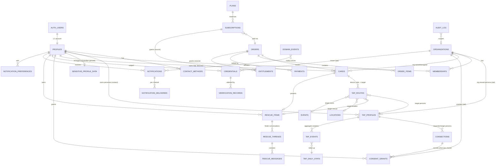

# 03 — Database / ERD Proposal

*Conceptual, ERD-level. Column lists are the **required** fields and constraints, not final DDL. Every migration must be idempotent, additive, and run in the CI chain from the captured baseline (doc 12, M0).*

**Legend:** ● existing & kept · ◐ existing, extended (additive columns/constraints) · ○ new · ✕ deliberately *not* created.

## 1. Entity decisions (necessity check against the master list)

| Master-doc entity | Decision | Realization |
|---|---|---|
| `users` | ● | Supabase `auth.users` — authentication only. Never queried by clients. |
| `profiles` | ◐ | Account record + `shygon_id` public handle. Contact channels move to `contact_methods`. |
| `tap_profiles` | ◐ | **Persona** (context-specific public profile). Table name kept. |
| `tap_devices` | ◐ | **= `cards` extended.** No second table. Exposed later through a view `tap_devices` if renaming is desired. |
| *(new)* `tap_routes` | ○ | Code → target routing + rules. Required by C1/C2. |
| `organizations` | ○ | Tenant. |
| `memberships` | ○ | User↔org affiliation (student/employee/member/attendee/guest) **and** optional admin role — one table. |
| `credentials` | ○ | Claims about a person (achievement, certificate, membership). |
| `verification_records` | ○ | Provenance/attestation per credential (who verified, how, expiry, revocation). Append-only. |
| `connections` | ○ | Consent-based relationship between two personas/users. |
| *(new)* `consent_grants` | ○ | **Central consent ledger** used by Connect, org visibility, emergency, temp access. |
| *(new)* `sensitive_profile_data` | ○ | Emergency/guardian/student-ID data, isolated from `tap_profiles`. |
| `events` | ○ (Phase 2) | Event definition + temporary modes. |
| `event_participations` | ○ (Phase 2) | User's role in an event (attendee/speaker/exhibitor/organizer). *Replaces the need for separate attendee/speaker tables.* |
| `locations` | ○ (Phase 4) | Physical place/object information nodes. |
| `location_content` | ○ (Phase 4) | Versioned, per-locale content blocks. |
| `access_policies` | ○ (Phase 5) | Declarative rules per resource. |
| `temporary_permissions` | ○ (Phase 5) | Time-boxed, revocable grants (a specialization of consent/permission). |
| *(new)* `access_decisions` | ○ (Phase 5) | Log of every policy evaluation. |
| `rescue_items` | ○ (Phase 3) | Protected item bound to a device. |
| `rescue_messages` | ○ (Phase 3) | Relay messages. Plus `rescue_threads` (conversation container). |
| `notifications` | ◐ | Add channel-agnostic fields; new `notification_deliveries`, `notification_preferences`, `domain_events` (outbox). |
| `subscriptions` | ○ | Plus `plans`. |
| `payments` | ● | Unchanged. |
| `analytics_events` | ◐ | **= `tap_events` extended** (no rename); add `tap_daily_stats` rollup. |
| `support_tickets` | ● / ◐ | Add `org_id`, category. |
| `audit_logs` | ◐ | **= `admin_audit_log` generalized** (actor_type, org_id); keep `admin_audit()` signature. |
| ✕ `roles`/`permissions` tables (platform) | ✕ | Platform roles stay in `admin_role_permissions()`. Tenant role→permission mapping is a small seed table `org_role_permissions` (data, so custom roles can arrive in Phase 5 without schema change). |
| ✕ separate `students`, `employees`, `attendees`, `hotels` tables | ✕ | All are `memberships.kind` / `personas.context` / `organizations.kind`. Prevents duplicate identity systems. |
| ✕ `hotel_guests`, `bookings` | ✕ | Belong to PMS integrations (Phase 5); modelled as `event_participations`-like external refs, not owned data. |

## 2. ERD (core, Phases 0–3)

Phase 4–5 additions (kept off the core diagram): `locations(org_id, parent_id, kind, geo, status)` ⟶ `location_content(location_id, locale, version, blocks jsonb, status)`; `events(org_id, starts_at, ends_at, venue_location_id, mode jsonb)` ⟶ `event_participations(event_id, user_id, role, persona_id)`; `access_policies(org_id, resource_type, resource_id, rule jsonb, min_assurance, effect)`; `temporary_permissions(subject, resource, action, valid_from, valid_until, max_uses, revoked_at)`; `access_decisions(...)`; `api_clients(org_id, ...)`, `api_keys(client_id, hash, scopes, last_used)`, `webhook_endpoints`, `webhook_deliveries`.

## 3. Table specifications (required fields / constraints)

### 3.1 Identity & privacy

**profiles ◐** — keep existing columns. Add: `shygon_id text UNIQUE NOT NULL` (opaque, non-sequential, e.g. `SHY-K7Q2-9XMD`; a display handle, *not* a secret and *not* a routing key), `locale text`, `deleted_at`, `deletion_requested_at`. Guard `suspended_*` (F1). `phone`/`email` on this table become *unverified draft values*; authority moves to `contact_methods`.

**contact_methods ○** — `id`, `user_id → profiles`, `kind ('email'|'phone')`, `value_normalized`, `verified_at`, `verification_method`, `is_primary_for_alerts bool`, `high_risk_eligible_after timestamptz` (cool-down after change), `created_at`. Unique `(kind, value_normalized) WHERE verified_at IS NOT NULL`. RLS: owner read; writes only via RPC/edge function after OTP. *Fixes F4.*

**tap_profiles ◐ (persona)** — keep all V5 columns. Add:
* `context text NOT NULL DEFAULT 'professional'` CHECK in `('professional','student','business','event','member','guest','other')`
* `org_id uuid NULL → organizations` (org-issued/branded personas, e.g. a school-issued student persona)
* `field_visibility jsonb NOT NULL DEFAULT '{}'` — map `field → 'public'|'connections'|'organization'|'private'` (see 04 §Privacy). Default for every field not listed = `private`. Existing rows are back-filled so that today's *enabled* fields become `public` (behaviour-preserving).
* `is_default bool` — exactly one default persona per user (partial unique index); the default persona is what a legacy `/t/<slug>` shows.
* Replace `UNIQUE(user_id)` with `UNIQUE(user_id, context, coalesce(org_id, zero-uuid))` **and** a plan-gated persona-count check (enforced in the same edit-rules trigger via entitlements: Essential = 1 persona; more via plan/Pass — product decision, doc 11 OQ-4).
* `slug` remains globally unique (case-insensitive) — vanity only.
* Existing triggers (`enforce_tap_edit_rules`, publication tracking, edit-window) keep working per row; the 14-day rule is *per persona* (decision OQ-5).

**sensitive_profile_data ○** — `user_id PK → profiles`, `kind` rows or jsonb columns for `guardian_contact`, `emergency_contact`, `medical_note` (**not in MVP; see doc 11 risk R-9**), `student_ref`; `encrypted` via `pgcrypto`/Supabase Vault (envelope key), `updated_at`. **No client SELECT policy for anyone except the owner; org/emergency reads only through SECURITY DEFINER release functions that require an active `consent_grant` and write an audit row.** Never joined into any public RPC.

**consent_grants ○** — `id`, `grantor_user_id`, `grantee_kind ('user'|'org'|'connection'|'emergency_responder'|'event')`, `grantee_id`, `resource_kind ('persona_fields'|'sensitive'|'credential'|'contact')`, `resource_id`, `scope jsonb` (explicit field list), `purpose text NOT NULL`, `source ('tap'|'invite'|'event'|'manual')`, `granted_at`, `expires_at` (NULL only allowed for `connection` kind), `revoked_at`, `revoked_by`, `version int`. Indexes on `(grantee_kind, grantee_id) WHERE revoked_at IS NULL`. **Append-only semantics:** revocation sets `revoked_at`; edits create a new row. Effective consent = latest un-revoked, un-expired row.

### 3.2 Devices, routing, lifecycle

**cards ◐ (tap_devices)** — keep existing columns. Add: `public_code text UNIQUE NOT NULL` (≥ 64 bits of entropy, Crockford base32, generated server-side at issue; this is what the chip/QR encodes for new devices), `device_kind ('card'|'tag'|'badge'|'label'|'hotel_device'|'embedded'|'virtual')`, `auth_mode ('static'|'sdm')`, `sdm_key_id text NULL` (reference to KMS key/version — **never the key**), `sdm_last_counter bigint`, `owner_org_id uuid NULL`, `assigned_to_user_id uuid NULL`, `assigned_persona_id uuid NULL`, `lost_at`, `retired_at`, `transfer_token_hash`, `batch_id`. Status set becomes: `unassigned | pending | shipped | active | suspended | lost | transfer_pending | replaced | retired` (CHECK added `NOT VALID` then validated — live constraint unknown, F6). Existing `activated_at/activation_expires_at` semantics resolved per OQ-1.

**tap_routes ○** — `id`, `device_id → cards` **or** `slug_persona_id → tap_profiles` (exactly one), `priority int`, `target_kind ('persona'|'rescue_item'|'location'|'event'|'org_page')`, `target_id uuid`, `condition jsonb` (`{"between":[ts,ts]}`, `{"state":"lost"}`, `{"event_id":…}`), `enabled`, `created_by`, `valid_from/valid_until`. Default route auto-created when a device is assigned to a persona (so today's behaviour = one route). Composite FK to keep `target` in the same owner/org as the device.

### 3.3 Tenancy

**organizations ○** — `id`, `slug UNIQUE`, `name`, `kind ('school'|'company'|'event_org'|'hotel'|'venue'|'other')`, `status ('pending_verification'|'active'|'suspended')`, `verified_at`, `verified_by` (platform admin), `domain` (optional, for email-domain claims), `plan_id`, `settings jsonb`, `created_by`, `deleted_at`. *Organization impersonation defense:* org must pass verification (admin review of domain/DNS/document) before it can issue **org_attested** credentials or show a "Verified organization" badge.

**memberships ○** — `id`, `org_id`, `user_id`, `kind ('student'|'employee'|'member'|'attendee'|'guest'|'staff')`, `org_role ('org_owner'|'org_admin'|'manager'|'staff'|'member'|'none')`, `status ('invited'|'active'|'suspended'|'ended')`, `external_ref` (student number etc., stored in org-scope only), `started_at/ended_at`, `invited_by`, `accepted_at`. UNIQUE `(org_id, user_id, kind)`. **A membership cannot become `active` without the user's acceptance** (or, for minors, a guardian consent record — Phase 2 legal review). At least one `org_owner` per org (deferred constraint trigger).

**org_role_permissions ○** — `(org_role, permission)` seed; permission strings namespaced: `members.read|invite|remove`, `devices.assign|revoke`, `credentials.issue|revoke`, `events.manage`, `locations.manage`, `analytics.read`, `billing.manage`, `api.manage`, `audit.read`.

### 3.4 Verify / Connect / Rescue

**credentials ○** — `id`, `subject_user_id`, `issuer_org_id NULL`, `type ('certificate'|'achievement'|'membership'|'skill'|'employment'|'education'|'event_pass')`, `title`, `data jsonb`, `evidence_url`, **`provenance ('self_asserted'|'org_attested'|'platform_verified')` NOT NULL**, `visibility` (default `private`), `status ('active'|'revoked'|'expired'|'pending')`, `issued_at`, `expires_at`, `public_verify_code` (unguessable, only if issuer opts in). A user can create only `self_asserted` credentials (enforced by trigger); `org_attested` only via `issue_credential()` by an org member with `credentials.issue`; `platform_verified` only by service/system functions (e.g., verified email/phone/payment).

**verification_records ○** — append-only: `credential_id`, `verifier_kind ('org'|'platform'|'admin')`, `verifier_id`, `method`, `evidence_ref`, `result ('verified'|'rejected'|'revoked')`, `at`, `expires_at`, `notes`.

**connections ○** — `id`, `requester_user_id NULL`, `requester_guest jsonb NULL` (name/contact **as voluntarily entered**, with consent flag), `requester_persona_id`, `target_persona_id`, `status ('requested'|'accepted'|'declined'|'blocked'|'expired'|'removed')`, `source ('tap'|'event'|'manual')`, `event_id NULL`, `shared_by_requester jsonb`, `shared_by_target jsonb`, `note`, timestamps. Sharing is recorded as `consent_grants`; the row stores only pointers. Unique `(requester, target)` while active.

**rescue_items ○** — `id`, `owner_user_id`, `device_id → cards (UNIQUE)`, `label` (owner-only), `public_hint` (what the finder sees), `state ('protected'|'lost'|'found'|'retired')`, `contact_policy jsonb` (channels allowed, quiet hours, digest), `reward_note` (optional, public only in `lost`), `lost_at`, `found_at`.

**rescue_threads ○** — `id`, `item_id`, `finder_token_hash` (secret link for finder, expires), `finder_session_hash` (HMAC of coarse fingerprint, for abuse counting only), `status ('open'|'owner_replied'|'closed'|'blocked'|'spam')`, `first_message_at`, `closed_at`, `abuse_score`.

**rescue_messages ○** — `id`, `thread_id`, `sender_role ('finder'|'owner'|'system')`, `body` (length-capped, links stripped by default), `moderation_state ('ok'|'flagged'|'removed')`, `delivered_at`, `read_at`. Retention: 90 days after thread close, configurable.

### 3.5 Commerce

**plans ○** — `code`, `kind ('individual'|'organization')`, `name`, `interval ('one_time'|'monthly'|'annual')`, `price_in_paise`, `features jsonb` (entitlement grants + limits: personas, seats, devices, analytics_retention, api), `active`. Existing SKUs (`plan-*`, `pass-customization`) are mirrored as `one_time` plans so both paths share one entitlement resolver (no duplicate systems).

**subscriptions ○** — `id`, `subject_kind ('user'|'org')`, `subject_id`, `plan_id`, `status ('active'|'past_due'|'cancel_at_period_end'|'canceled'|'expired')`, `current_period_start/end`, `provider ('razorpay')`, `provider_subscription_id NULL`, `latest_order_id`, `cancel_requested_at`.

**entitlements ◐** — add `subject_kind` (default `'user'`), `org_id NULL`, `source ('order'|'subscription'|'admin_grant'|'plan_default')`, `source_subscription_id`, `expires_at NULL`. Unique `(user_id, type, key)` preserved for user rows; add unique for org rows. `effective_entitlements(subject)` function unions active rows + plan defaults. Stored key vocabulary unchanged.

**orders ◐** — add `subject_kind`, `org_id NULL`, `billing_gstin` (Phase 4). Nothing else changes; `admin_note` moves per proposed 011.

### 3.6 Notifications, analytics, audit

**notifications ◐** — add `org_id`, `dedupe_key`, `severity`, `category` (existing), `expires_at`. **notification_deliveries ○** (`notification_id`, `channel ('in_app'|'email'|'sms'|'push')`, `status`, `provider_message_id`, `attempts`, `last_error`, `sent_at`). **notification_preferences ○** (`user_id`, `category`, `channel`, `enabled`, `quiet_hours`, `digest`). Security-critical categories can't be disabled. **domain_events ○** (transactional outbox): `id`, `type`, `aggregate`, `aggregate_id`, `org_id`, `payload jsonb` (no PII beyond ids), `created_at`, `processed_at`, `attempts`. Producers insert in the same transaction as the state change.

**tap_events ◐** — add `device_id`, `route_kind`, `trust_level`, `country_code`, `context` (`persona|rescue|location|event`), `source ('nfc'|'qr'|'link')`. **No IP, no UA, no precise location.** `visitor_hash` becomes HMAC(server_secret_v, daily-rotating). New **tap_daily_stats ○** (`day`, `subject_kind`, `subject_id`, counts, `uniques_approx`). Partition `tap_events` monthly when > ~10M rows.

**audit_log ◐ (admin_audit_log)** — add `actor_kind ('user'|'admin'|'org_member'|'system'|'api_client')`, `org_id`, `request_id`, `ip_hash`, `outcome ('allowed'|'denied'|'error')`, `before_hash/after_hash` (not raw PII). Append-only enforced (no UPDATE/DELETE grants, rule/trigger). `admin_audit()` keeps its signature.

## 4. Relationship, ownership & lifecycle summary

| Entity | Owner | Tenant key | Lifecycle | Soft delete | Retention |
|---|---|---|---|---|---|
| profiles | user | user_id | active → deletion_requested (30-day grace) → erased | `deleted_at` | erase PII; keep financial/audit records de-identified as required |
| tap_profiles | user (org for org-issued) | user_id / org_id | draft→active→paused→archived | archived | with account |
| cards/devices | user or org | user/org | unassigned→pending→shipped→active⇄suspended→lost→retired; replaced | never hard-deleted | permanent (serial integrity) |
| tap_routes | device | via device | created on assign | `enabled=false` | with device |
| memberships | org+user | org_id | invited→active→ended | `ended` | 7 yrs? **counsel** (OQ-9) |
| credentials | subject | user_id | pending→active→revoked/expired | revoked | subject controls; issuer record retained |
| consent_grants | grantor | user_id | granted→(expired\|revoked) | append-only | ≥ 3 yrs as evidence (counsel) |
| connections | requester/target | user_id | requested→accepted→removed | `removed` | until either side deletes |
| rescue_* | owner | user_id | protected⇄lost→found | thread close | messages 90d after close |
| orders/payments | user/org | user/org | existing | never | statutory (GST/Companies Act—counsel) |
| tap_events | persona/device | persona/device | append | n/a | raw 90d → rollups 25 mo |
| audit_log | system | org_id/global | append | never | ≥ 2 yrs (security), configurable |

## 5. Indexing & performance requirements

* Resolver hot path: `cards(public_code)` unique; `tap_profiles(lower(slug))` unique (exists); `tap_routes(device_id, priority)`; **cache resolved payloads at the edge for ≤ 30 s** for `T0` requests (invalidate on persona publish via tag) — protects the DB from tap storms at events.
* Tenant scans: every `(org_id, …)` composite index leading with `org_id`.
* Partial indexes for "active only" (`WHERE revoked_at IS NULL`, `WHERE status='active'`).
* RLS helper functions declared `STABLE`, `SECURITY DEFINER`, `search_path` pinned; policies wrap `auth.uid()` as `(SELECT auth.uid())` (V5 already learned this in migration 007).

## 6. RLS requirements (per table class)

| Class | Policy shape |
|---|---|
| User-owned (personas, credentials-as-subject, contact_methods, consent_grants as grantor, rescue_items, notifications) | `USING ((SELECT auth.uid()) = user_id)`; **writes that carry security meaning go through RPC**, not raw PATCH. |
| Org-owned (memberships list, org devices, org events/locations, org analytics) | `USING (public.has_org_permission(org_id, '<perm>'))` |
| Cross-visibility (org viewing a member's persona) | Never by table policy. Via a SECURITY DEFINER read function that joins `consent_grants` + `field_visibility`, returns only permitted fields, and audits. |
| Append-only (audit_log, verification_records, consent_grants revoke-only, access_decisions) | No UPDATE/DELETE policy; `REVOKE UPDATE, DELETE` from `authenticated`; writes via definer functions. |
| Server-only (payments, webhook_events, card_otp_challenges, subscriptions state, outbox) | RLS on, no policies, `REVOKE ALL` from anon/authenticated. |
| Public data | **No anon table policies.** Anonymous access only via whitelisted definer functions (v1 kept) or the edge resolver. |

**Column-level guard pattern (fixes F1/F2 class):** any column a customer must not change (`suspended_*`, `status` when suspended, `org_id`, `is_default`…) is protected by a BEFORE UPDATE trigger that compares OLD/NEW when `auth.uid() IS NOT NULL AND NOT is_admin()`, and every such column gets a line in `rls-adversarial.mjs`.

## 7. Sensitive-data boundaries

| Tier | Examples | Stored | Who can ever read |
|---|---|---|---|
| S0 public | display name, headline, public links | `tap_profiles` | anyone (if field visibility = public) |
| S1 personal | phone, email, location on persona | `tap_profiles` | per `field_visibility` + consent |
| S2 account | login email, orders, address | `profiles`, `orders` | owner; support with reason |
| S3 sensitive | guardian/emergency contact, student refs, DOB | `sensitive_profile_data` (encrypted) | owner; consented release only, logged |
| S4 secrets | OTP hashes, SDM keys, API key hashes, webhook secrets | server-only tables / KMS | services only; never exportable |
| ✕ never stored | precise finder location by default, raw IP/UA, card numbers/CVV, government IDs, health records (MVP) | — | — |
