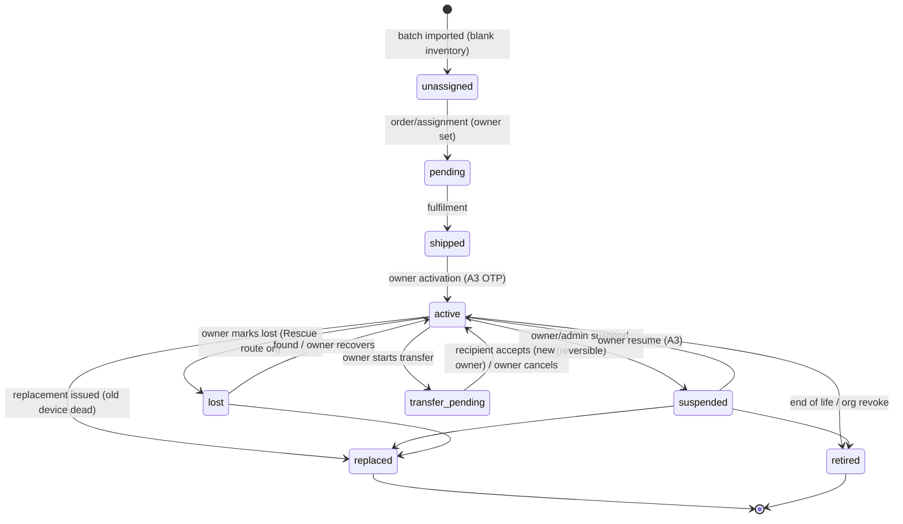

# 08 — Hardware / Tap Lifecycle Architecture

## 1. The abstraction

> A physical SHYGON object is a **Tap Device** (`cards` table, extended). The device holds **only an opaque identifier** (and optionally a cryptographic counter/signature). Everything meaningful — who owns it, what it points to, whether it works — is server-side state that can change without touching the object.

Supported forms, one model: **card** (PVC/metal/transparent, existing), **tag/sticker** (Rescue), **badge/lanyard** (events/school), **label** (products, retail), **hotel device / stand** (Privé), **embedded NFC** (OEM), **virtual** (QR-only/digital, no chip), and future SHYGON hardware — differing only by `device_kind`, `auth_mode`, and default route rules.

## 2. Identifiers (three, never confused)

| Identifier | Where it lives | Secret? | Purpose |
|---|---|---|---|
| **Chip UID** (`card_uid`) | Manufacturer-burned in chip; recorded at encoding | No (readable by anyone, cloneable) | Inventory/QA, provenance. **Never used for routing or trust.** |
| **Public code** (`public_code`) | Encoded in NDEF URL and QR: `https://shygontech.com/d/<code>` | Semi-public (anyone who taps sees it) — but unguessable (≥ 64 bits) | Route lookup |
| **Device key** (SDM, optional) | In chip secure memory + derived server-side from KMS master + `device_id` | **Yes** | Proves chip authenticity per tap (CMAC + counter) |
| Vanity slug `/t/<slug>` | Persona | No | Human-friendly persona URL; legacy printed cards |

## 3. Chip strategy (decision needed — OQ-2)

| Tier | Chip | Auth | Cloneable? | Use |
|---|---|---|---|---|
| Baseline | NTAG213/215/216 (static NDEF, locked) | none (T0) | Yes, trivially | Business/personal cards, location tags where a clone is harmless |
| Recommended for new batches | **NTAG 424 DNA** (SDM: encrypted UID+counter+CMAC in URL) | T1 authenticated tap | Clone yields stale/replayed URL → rejected | Rescue tags, badges, anything with ownership meaning; **required for any future Access** |
| Access-grade (Phase 5) | DESFire EV3 / secure element via reader, **not** phone-URL | Mutual auth | No | Physical access (doors) — out of scope of tap-URL model; integrates via controller |

Cost note (for the owner to price): NTAG 424 DNA inlays cost more than NTAG21x, and metal-card encoding needs an ISO-compliant, RF-tested layout — confirm with the card manufacturer whether the current metal/transparent designs can carry a 424-class inlay.

## 4. Lifecycle state machine

**Resolution behaviour per state** (resolver, fixes F3)

| State | Tap result |
|---|---|
| `unassigned`, `pending`, `shipped` | Generic "Activate your SHYGON Tap" landing (claim flow requires signed-in owner + activation secret from the package/order) |
| `active` | Route → target (default: persona) |
| `suspended` | Neutral "This Tap is currently unavailable" (no owner info) |
| `lost` | Rescue route (if `rescue_item` exists) else neutral unavailable; **the persona is not shown** |
| `transfer_pending` | As `active` (owner keeps control until accepted) |
| `replaced`, `retired` | Neutral unavailable + optional "This card was replaced" hint if owner opts in |

## 5. Operations

**Activation.** Owner signs in → enters/scans activation secret (printed on packaging insert, stored hashed) → device `shipped→active`, bound to owner and default persona; route created; `device.activated` event + notification. *(14-day validity semantics: OQ-1.)* Activation via OTP stays but uses **verified** phone.

**Ownership & assignment.** `owner_user_id` (or `owner_org_id`) is the controlling party. Orgs may **assign** an org-owned device to a member (`assigned_to_user_id`) without transferring ownership — assignment is revocable by the org; the member controls the persona, the org controls the device. A member cannot transfer/retire org-owned devices.

**Transfer (resale/gift).** Owner starts transfer → server issues one-time transfer token (hash stored, 72 h expiry) → recipient (signed in) accepts with A3 → device rebinds: old routes disabled, old owner's rescue/persona bindings removed, recipient must complete activation, `device.transferred` audit + notifications to old owner (all channels). Lost/blocked/suspended-by-admin devices cannot be transferred. Second-hand devices without a transfer token require admin-verified proof (invoice/serial) → `admin_reassign_device` with reason + audit (**anti false-ownership-claim**).

**Replacement.** New device issued (no new edition serial — existing rule), inherits routes/persona; old device → `replaced` immediately (hard stop). Free/paid policy is business decision.

**Suspension / deactivation.** Owner (A3) or admin. Immediate at resolver (cache ≤ 30 s; purge tag on change). Audited; notification to owner; admin reason mandatory.

**Rebinding.** Changing a device's default target = editing its `tap_routes` (audited, notified, versioned).

**Retirement.** Terminal. Keeps serial/edition history; frees no code (codes never reused).

**Batch issuance (org & manufacturing).** `admin_issue_batch(sku, qty, kind, auth_mode)` creates `unassigned` devices with codes and (for SDM) key-derivation ids; export a **manufacturing manifest** (code, UID slot, encoded URL) via signed, expiring, audited download; UID captured at encoding via a controlled encoding station tool (Phase 1 script, not customer-facing). Integrity: manifest hashes; encoded-vs-registered reconciliation report.

**QR fallback.** Every device prints the same `/d/<code>` as a QR (device-code URL, not persona vanity), so a lost/replaced card's QR follows the lifecycle rules too. QR visits log `source=qr`. Persona QR page (existing `TapQr`) continues to encode `/t/<slug>` for personas shared without a device.

**Analytics.** `tap_events.device_id`, `source`, `trust_level`; per-device counts for owner; per-batch health (CMAC failure rate, dead-on-arrival) for admin.

## 6. Legacy compatibility (non-negotiable)

Every card already shipped resolves at `/t/<slug>` and **must keep working forever**. Migration adds `public_code` to existing `cards` rows (backfill) and a default route to each user's default persona; **the legacy resolver path is untouched.** Legacy cards are `auth_mode='static'`, `device_kind='card'`. Because a legacy chip's URL names the *persona*, not the device, `suspend/lost` on a legacy card can only be honoured by pausing the persona or via the "legacy card ⇒ persona-level gating" rule (explicit decision OQ-2b): *if the owner has exactly one active legacy device, its state gates `/t/<slug>`; with multiple, the persona stays reachable while any legacy device is active.*

## 7. Requirements for future hardware
A new device type must supply: (1) an opaque code scheme compatible with `public_code`; (2) an auth mode; (3) lifecycle mapping; (4) a route template; (5) encoding manifest format; (6) tests: encode→tap→resolve loop on real phones (iOS/Android, background tag reading vs. in-app), and a metal/transparent RF read-range check. No new tables per hardware type.
