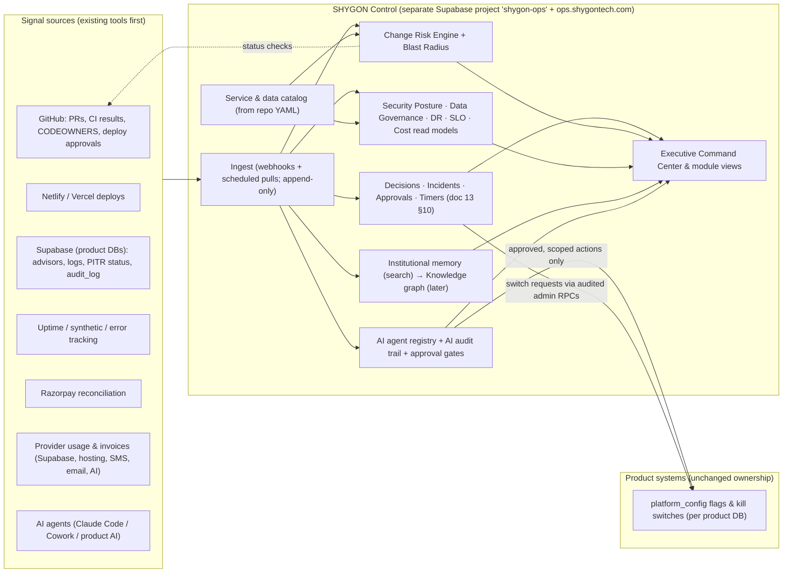

# 14 — SHYGON OS Operating Layer (Engineering, Security, Data, Release & AI Operations)

**Source:** the 19-capability proposal ("Executive Command Center … Cost Intelligence") plus §20, "The Bigger Opportunity". As requested, this is a separate module after the governance spec (doc 13): *doc 13 = governance and emergency system; doc 14 = the broader operating and intelligence architecture that runs the organization.*

---
## 1. First, a naming and scope decision (OQ-21)

The pack now uses "SHYGON OS" for two different things:

| | **SHYGON OS — Platform** (docs 01–12) | **SHYGON OS — Operating Layer** (this doc; working name **SHYGON Control**) |
|---|---|---|
| Users | Customers, organizations (schools/hotels/events), platform admins | SHYGON's own staff and AI agents |
| Purpose | Physical-to-digital identity & services | Running the technology organization: decisions, incidents, releases, security, data, AI, cost |
| Data | Customer/tenant data | Operational metadata: decisions, incidents, deploys, risk scores, catalogs, audit |
| Scope | SHYGON Tap (then Student, Rescue…) | **All SHYGON products:** Tap, School OS, Privé, future ones |

**Recommendation:** treat them as **two bounded contexts with separate data stores** and name them distinctly, e.g. "SHYGON OS" (the product) and "SHYGON Control" (internal). This is a **Product Owner decision**, and it matters for three reasons:

* **Blast radius.** An incident system hosted inside the platform it monitors fails exactly when it's needed (doc 13 GAP-7). A customer-platform compromise must not expose incident, security-posture or decision records.
* **Multi-product.** School OS (transport tracking, school operations) and Privé will generate the same operational needs. One control layer serves all of them.
* **Commercial optionality.** If §20's "operating layer for running a technology organization" is ever sold, it must already be separate from customer identity data.

---
## 2. Architecture of SHYGON Control



**Design rules**
1. **Existing tools first, software second.** Every capability starts as *process + CI + an existing tool*. It becomes in-house software only when (a) the tool can't enforce what governance requires, or (b) aggregation across tools is the value. This keeps a small team from building 19 products.
2. **Control observes and requests; product systems execute.** SHYGON Control never holds product database superuser credentials. Actions go through the same audited admin RPCs and kill switches that humans use, with scoped service credentials.
3. **Append-only by default.** Ingested events, decisions, approvals and AI actions are immutable, with corrections as new records. The governance audit is hash-chained (doc 13 §10.2).
4. **Out-of-band survivability.** Control runs on a separate project/deploy. Paging and the incident channel stay external (doc 13 §9). The Command Center works in a degraded, read-only cached mode.
5. **Staff-only, MFA-required, least privilege.** Separate staff identities with no customer accounts reused. Roles come from `ops.role_assignments` (doc 13).
6. **No surveillance creep.** Workload views show *counts by role and queue*, never individual productivity scoring (the G§87 principle: signals, not blame).

---
## 3. Capability specifications

Each capability lists: **Purpose → Design → Data/sources → Delivered as → Phase → Build-vs-buy note.** Phases use the combined stage codes in §5.

### 3.1 Executive Command Center (#1)
* **Purpose:** one screen for leadership: active P0/P1, blocked decisions, critical deployments, security alerts, data-risk events, overdue approvals, workload, system health, current escalations.
* **Design:** read models built over §3.2–3.19, with each tile deep-linking into its module. It refreshes live via realtime on the ops DB, and falls back to cached data with a "stale since" banner. The top strip is the doc 13 P0 panel whenever any P0 is open.
* **Workload:** open items per role and queue (decisions, approvals, action items, review requests), with ageing. No per-person scoring.
* **Delivered as:** in-house (it's the aggregation value). **Phase:** O3, together with the doc 13 G3 Command Center.
* **Before O3:** a weekly generated "ops digest" (markdown/HTML artifact) built from CI + monitoring gives most of the value at near-zero cost (O1).

### 3.2 Decision Intelligence (#2)
* **Record:** `Question → Evidence → Options → Risks → Owner → Decision → Result`. This is doc 13's `ops.decisions`, plus two fields: **`expected_outcome`** (at decision time) and **`observed_result` + `result_reviewed_at`** (at a review date set when deciding). Without a recorded result, nothing can be learned later.
* **Suggestions** ("previously successful patterns") need volume. Until ~100+ decisions with reviewed results exist, the feature is **similar-decision retrieval** (full-text, then semantic search), shown as "related past decisions". It is never an automated recommendation of the answer.
* **Phase:** records O0 (repo markdown) → O3 (DB) → retrieval O4 → pattern suggestions O5+ (with AI, governed by §3.9/3.18).

### 3.3 Dependency & Blast-Radius Map (#3)
* **Source of truth:** a **machine-readable service catalog** in the repo, `catalog/`, with a YAML entry per component.
  * **Fields:** `id`, `owner_role`, `tier` (critical/high/normal), `depends_on`, `data_stores`, `data_classes` (S0–S4 from doc 03), `paths` (globs), `public_surface` (bool), `slo`, `runbook`.
  * **Components:** resolver, public renderer, customer app, auth, payments (create/verify/webhook/fulfilment), refunds, notifications worker, SMS/OTP, admin RPCs, Admin APK, DB (per schema area), storage, DNS/CDN, and later school/Privé components.
* **Blast-radius computation:** changed files → matched components → transitive dependents → affected user journeys (e.g., "tap → resolve → render", "checkout → webhook → fulfilment") → "what could break" list. The output goes in the PR comment and the risk engine input.
* **CI guard:** CI fails if a new source path isn't covered by any catalog entry, so the map can't rot.
* **Delivered as:** YAML + a small Node script in CI (O0). A visual map is rendered from the same YAML in Control (O3).

### 3.4 Change Risk Engine (#4)
* **Output:** Low / Medium / High / Critical, mapped 1:1 onto governance levels **L0 / L1 / L2 / L3** (doc 13 §3). The approvals required come from those levels.
* **Rule inputs (v1, deterministic and explainable):**

| Signal | Weighting rule |
|---|---|
| Paths touched (catalog tier) | critical component → ≥ High |
| DB migration present | ≥ High; with DROP/ALTER TYPE/DELETE/UPDATE without WHERE/rename → **Critical** |
| RLS / POLICY / SECURITY DEFINER / GRANT / REVOKE / `auth.` in SQL | **Critical** |
| Auth code, OTP, session, MFA | **Critical** |
| Payment paths | **Critical** |
| Public surface (resolver, public endpoints, headers/CSP) | ≥ High |
| Physical-card-visible semantics (URL scheme, lifecycle, route rules) | **Critical** (irreversible, doc 13 §3.3) |
| Production scope (flagged-off vs default-on) | lowers one level only if shipped behind a default-off flag **and** not DB/auth/payment |
| Reversibility (rollback SQL present, expand-only migration, flag) | missing rollback on High+ → gate fails |
| Size/complexity (files, lines) | adds at most one level |

* **Explainability:** the engine **explains every point it adds**, so there are no opaque scores. A human may *raise* the level; lowering it needs an override reason recorded on the PR (the doc 13 §1.2 rule).
* **Delivered as:** a CI script + a PR label + required-reviewer assignment (O0). History is stored in Control for trend analysis (O3). An ML-based risk model is **not planned**, since deterministic rules are auditable.

### 3.5 Automated Pre-Deploy Gate (#5)
The stages, in order, are Code → Tests → Security → Database → Performance → QA → Rollback plan → Approval → DEPLOY. A critical gate failing stops the deploy.

| Gate | Checks (v1) | Blocking at |
|---|---|---|
| Code | lint, typecheck, build | all |
| Tests | unit/function tests, `db:verify`, `rls-adversarial`, `test:payments`, golden legacy slugs, public-leak snapshot | all |
| Security | secret scan, dependency audit (high+), definer-function lint, CSP/header diff check, SAST (CodeQL) | all; High+ requires Security Owner approval |
| Database | migration lint (idempotency, rollback SQL, no destructive ops without DEC id), apply on empty DB **and** on a scrubbed staging copy, row-count/constraint checks | when a migration is present |
| Performance | bundle budgets (public Tap ≤ 90 kB gz), k6 smoke on preview for resolver changes | High+ or public surface |
| QA | Playwright smoke + axe on preview; QA Owner check for L2+ | L2+ |
| Rollback plan | PR field present and specific; migration expand-only or rollback SQL; flag name for feature | L2+ |
| Approval | CODEOWNERS + **GitHub Environment "production" protection** (named approvers per level) | L1+: 1 approver; L3: specialist + Release Owner |
| Deploy → verify | post-deploy watch window (§3.12) | all production deploys |

* **Delivered as:** GitHub Actions + branch protection + environment protection rules (O0/O1).
* **Improvement over V5:** production **migrations move from "paste in SQL editor" to an approved pipeline job**. The job applies to staging, waits for approval, then applies to production using a scoped Supabase access token held only in the production environment secret. This gives reproducible, audited, gated database changes. It is done in O1, after the baseline (M0.2) is proven, and the manual path remains as documented break-glass.

### 3.6 AI Change Reviewer (#6)
* **What it does:** Claude analyzes each PR and posts a structured review: WHAT CHANGED · WHY (from PR/DEC) · RISKS · AFFECTED SYSTEMS (from the catalog) · SECURITY IMPACT · DATA IMPACT · BREAKING-CHANGE RISK · ROLLBACK PLAN (checks the one given) · REQUIRED APPROVALS (from the risk engine).
* **Rules:**
  1. The review is **advisory**. It never approves, never counts toward required reviews, and can't merge (§3.9).
  2. It must **cite files/lines** for each risk. Unsupported claims are flagged as hypotheses (G§67 evidence classes).
  3. It flags **disagreements with the deterministic risk engine** for human attention rather than overriding it.
  4. It runs with **read-only repo access** and no secrets. Diffs containing secrets are blocked before sending.
  5. Every run is logged in the AI audit trail (§3.18).
* **Delivered as:** a CI job calling Claude (or a Claude Code review session) posting a PR comment (O0/O1).

### 3.7 Knowledge Graph (#7)
* **Model:** People ↔ Roles ↔ Systems ↔ Decisions ↔ Incidents ↔ Code ↔ Deployments ↔ Customers.
* **Implementation:** **relational edges in Postgres** (`ops.entities(kind, ref)`, `ops.edges(from, to, relation, source, valid_from/to)`), populated from the catalog, PRs (paths → components), deploy records, decision/incident links and org records. **No graph database.** Queries are recursive CTEs; add a graph engine only if query needs outgrow SQL.
* **Customer nodes** carry org id and tier only; customer PII never enters Control.
* **Phase:** O4. The raw links (PR ↔ DEC ↔ incident ↔ deploy) are captured from O0 via IDs in PR templates and commit trailers, so the graph can be back-filled.

### 3.8 Institutional Memory (#8)
* **Content:** after every major incident or decision, record *what happened → what was learned → what to do differently*. These are fields on post-incident reviews and decision results (doc 13 §10.2), plus "lessons" entries.
* **Search:** full-text (Postgres FTS) over decisions, incidents, reviews, runbooks, ADRs (O3). Semantic search (pgvector) plus an AI "ask the archive" with citations (O4).
* **Writing it is a closure requirement.** Search answers must link sources; no uncited AI answer.

### 3.9 AI Agent Permission System (#9)

**Principle:** agents get the least privilege, enforced *technically* (credentials, branch protection, environment rules), not only by policy text. **No agent can delete, and no agent can approve.**

| Agent | Read | Write | Deploy | Delete | Approve | Hard boundary (enforced by) |
|---|---|---|---|---|---|---|
| Research Agent | ✓ public web, docs, repo (read) | — | — | — | — | no repo write token |
| Coding Agent (Claude Code) | ✓ repo; local/PGlite; **staging** DB read | ✓ feature branches & PRs only | — | — | — | branch protection (can't push to main/merge); **no production credentials in agent environments**; can't apply migrations to live (doc 12 §0) |
| QA Agent | ✓ repo, preview/staging | tests & test data on **staging** only | — | — | — | staging-scoped DB role; test-data namespace |
| Security Agent | ✓ repo, scan results, advisors, audit views | findings/issues, draft PRs for fixes | — | — | — | may *request* containment (creates `ops.change_requests`); **cannot pull switches** |
| Release Agent (O4+, optional) | ✓ | release notes, release records | ✓* | — | — | *only an artifact whose commit SHA a human already approved in the release record, inside an approved window, with a verification plan attached; **may auto-rollback stateless deploys** (§3.12); **never runs migrations** |
| Incident/Ops Agent (Cowork) | ✓ incident records, monitoring | drafts: classification, status updates, timelines | — | — | — | external communications require human approval (doc 13 §9) |
| Product AI features (doc 09) | only the data the feature needs | suggestions objects only | — | — | — | per-feature scopes + K18 kill switch |

**Mechanisms:**
* **Agent registry** `ops.agents`: id, owner (human accountable), purpose, scopes, credentials refs, environment, expiry, status.
* **Separate identities:** each agent uses a separate GitHub App or bot account and a separate Supabase role.
* **Credential expiry:** all agent credentials are short-lived and rotated.
* **Kill switch per agent:** disable an agent's identity in one action. This is **K19**; add it to doc 13 §7.

### 3.10 Human Approval Gates (#10)
* **Flow:** AI proposes → AI explains → human reviews → human approves → system executes → system verifies.
* **Implemented as `ops.change_requests`:** proposer (human or agent), operation type, target, risk level, explanation, dry-run output, required approvals (from level), executor (system job with scoped credential), verification result.
* **Mandatory for:** production database changes, security changes, authentication, payments, data deletion, major deployments, kill-switch changes outside a declared P0, secret rotation, admin role changes.
* **Rules:**
  * The approver must be a **human who didn't propose the change** (proposer ≠ approver, including "agent run on behalf of X" → X can't approve).
  * **The executing system — not the approver — performs the action,** so that what was approved is exactly what runs (hash of the approved payload is checked).
* **O0/O1:** realized as GitHub PR review + Environment approval + DEC record. **O3:** a native approvals UI for non-code operations.

### 3.11 Customer Impact Simulator (#11)
* **Questions it answers:** for a proposed change, which customers, organizations, features, users, potential downtime, potential data impact.
* **Design:** blast radius (§3.3) → affected features → **feature-usage aggregates** from the product analytics rollups (doc 06: counts per org/feature/day, no PII) → estimated affected orgs/users. Add the downtime estimate (from the migration plan: lock time, backfill duration) and data impact (tables/rows touched by migration dry-run on staging copy).
* **Education focus:** for School OS/Student, add calendars (exam days, school hours) so risky deploys are flagged in sensitive windows.
* **Phase:** O4 (needs orgs, usage rollups, catalog). A manual checklist version goes into the PR template now.

### 3.12 Automated Rollback Intelligence (#12)
* **Loop:** Deploy → Monitor → Detect anomaly → Evaluate → Rollback/Continue.
* **Last known good:** each production deploy records `deploy_id`, commit, flags state and migrations applied. **"Last known good"** = the most recent deploy that passed its watch window.
* **Watch window:** 15 minutes (30 for L3). The error rate, resolver/auth/checkout SLO indicators, and synthetic probes are compared with the pre-deploy baseline.
* **Actions by change type:**

| Change type | On anomaly |
|---|---|
| Frontend/functions only | **auto-rollback** to last known good (O1 notify-only; O2 automatic, behind a flag) |
| Feature behind flag | auto-disable the flag (fast, no redeploy) |
| DB migration | **never auto-rollback**; page the Data Owner; expand/contract design means the app rollback is safe while the schema stays |
| Config/secret | page the Release Owner |

* **Guard:** no auto-rollback during an active P0 unless the Incident Lead enables it.

### 3.13 SLO / SLA Monitor (#13)
* **Services:** authentication, API (public resolver + functions), database, website, customer app, notifications, payments, **transport tracking (School OS)**, AI services. The Tap-platform SLOs are in doc 13 §6. School OS and AI SLOs are defined when those services exist (flagged as out-of-scope placeholders here).
* **View:** Target → Current → Breach → Duration, plus error-budget burn rate (fast/slow burn alerts).
* **Delivered as:** an external monitoring/uptime tool plus the error tracker (O1). Aggregated into Control (O3). SLAs to customers only in Phases 4–5 (enterprise).

### 3.14 Security Posture Center (#14)
Each domain is scored Healthy / Warning / Critical against explicit thresholds:

| Domain | Signals | Critical if |
|---|---|---|
| AUTH | admin MFA coverage, OTP abuse rate, password-reset anomalies | any admin/org-admin without MFA |
| RLS | adversarial suite on main, cross-tenant canary, definer lint, Supabase security advisor | any failure |
| SECRETS | last rotation vs policy, scanner hits, secrets in two runtimes | leaked secret / rotation > 2× overdue |
| DEPENDENCIES | audit high/critical, age of lockfile updates | critical vuln unpatched > 7 days |
| API SECURITY | rate-limit breaches, 4xx/5xx anomalies, public-leak canary | canary hit |
| DATABASE | backups, PITR status, public schema exposure, advisors | backups failing |
| ACCESS CONTROL | admin roster review date, stale admins, break-glass use | unreviewed > 90 days or unexplained break-glass |
| AUDIT LOG | append-only violations, hash-chain verification, gaps | any violation |
| INCIDENTS | open P0/P1, overdue action items | open P0 |

* **Delivered as:** a generated weekly report from CI + advisors (O1). A live dashboard in Control (O3).

### 3.15 Data Governance Center (#15)
* **Tracks:** what data exists · where · who can access · retention · encryption · deletion policies · backups · data movement (processors: Razorpay, SMS, email, AI, hosting) · tenant boundaries.
* **Source of truth — enforced by CI:**
  * Every table and column carries a classification comment: `COMMENT ON COLUMN … IS 'class=S1;retention=account;pii=phone'`.
  * A CI lint fails on unclassified columns.
  * `catalog/data/*.yaml` lists stores, processors, regions, retention and legal basis.
* **Generated from that:** a **data inventory** and **record of processing** (useful for DPDP compliance; counsel to confirm form); access matrix from RLS policies + roles; retention job status; legal holds (doc 13 K14).
* **Phase:** catalog + lint O1 (with Phase 1 schema work); dashboard O3; **mandatory before student data (Phase 2)**.

### 3.16 Disaster Recovery Center (#16)
* **Loop:** Backup → Restore → Verify.
* **Tracks:** last successful backup, backup health, restore-test result, RPO, RTO, critical dependencies.
* **Proposed objectives** (Data Owner + Product Owner approve):

| Asset | RPO | RTO | Mechanism |
|---|---|---|---|
| Product DB | ≤ 5 min | ≤ 4 h full restore; tap path degraded mode ≤ 5 min via K1 static page | Supabase PITR (**confirm plan includes PITR**) |
| Storage objects (avatars, org documents) | ≤ 24 h | ≤ 8 h | **Separate backup job** (verify: Supabase DB backups may not include Storage object files) |
| Ops DB (Control) | ≤ 1 h | ≤ 8 h | its own backups |
| Code/config | 0 | ≤ 1 h | GitHub + IaC/env export (secrets excluded) |
| DNS/domain | — | ≤ 1 h | registrar lock + documented recovery |

* **Monthly restore test** to staging with row counts, checksums and invariant checks, recorded as evidence.
* **Dependencies list** with an exit note per vendor: Supabase, Netlify/Vercel, Razorpay, MSG91/Twilio, email provider, registrar, GitHub, paging service.
* **Phase:** O0 (verify PITR + first restore drill) → O1 (monthly automation) → O3 (dashboard).

### 3.17 Feature Flag System (#17)
* **Rollout stages:** Development → Internal → 5% → 25% → 50% → 100%, with instant disable.
* **Build vs buy:**
  * **Built in:** extend `platform_config` into `feature_flags(key, stage, percentage, allow_orgs[], allow_users[], deny_*, kill bool, owner, expires_at)`. Evaluation is by a stable hash of user id (or org id for org features), in both DB (for triggers/RPCs) and edge functions (cached ≤ 30 s).
  * **Why built in:** the same table carries **kill switches** that DB triggers must read. An external flag service (GrowthBook/Unleash) can be added later for *experiments*, but not for security switches.
* **Rules:**
  * Every flag has an owner and an **expiry**. CI warns on flags older than 90 days.
  * Flag changes in production are audited, and stage increases for L3 features need approval.
  * Flags are **never** used to hide an authorization check. Auth is enforced regardless of flags.
* **Phase:** O1 (it's a prerequisite for the Phase 1 resolver rollout and kill switches).

### 3.18 AI Audit Trail (#18)
* **`ops.ai_actions` (append-only):** agent · request · context refs (not raw PII) · recommendation · tools used · changes proposed (diff/PR ref) · human approval ref · action · result · timestamp · model/version · cost.
* **Today (O0):** commit trailers already carry `Claude-Session` links, and the PR template records "AI-assisted: yes/no, agent, session link, human reviewer". CI blocks a merge of an AI-authored PR without a human approver.
* **O3:** ingest into Control automatically. Product AI features (doc 09) write to the same schema from day one of their existence.

### 3.19 Cost Intelligence (#19)
* **Dimensions:** product · customer · feature · API · AI model · environment.
* **Sources:** provider usage APIs and invoices, `notification_deliveries` (per-message SMS/email cost), AI token logs (§3.18), function invocations, DB size/egress.
* **Attribution:**
  * direct where metered (SMS per org, AI per feature);
  * allocation keys elsewhere (DB cost by row/egress share).
* **Anomalies:** daily budget per provider and per feature; alert at 2× trailing baseline; **circuit breakers** for SMS and AI spend (already required in docs 06/09).
* **Phase:** budgets and alerts O1; attribution per customer/feature O4 (needs orgs & usage rollups).

---
## 4. §20 "The Bigger Opportunity" — assessment

**The idea:** SHYGON OS as an *operating layer for running a technology organization*, with human + AI governance across product, engineering, security, data, operations, AI, incidents, decisions, releases and institutional memory.

**Honest assessment**
* **Strength:** there is a real gap in *integrated* human + AI governance. Agent permissions, approval gates, AI audit and decision memory are not well unified in today's tooling, and SHYGON will dogfood it across several of its own products.
* **Competition:** each individual module competes with mature categories: incident management, internal developer portals/service catalogs, feature flags, observability/SLOs, security posture tools, data catalogs. Selling it means competing on integration and AI governance, not on any one module.
* **Risk:** it's a different customer (engineering organizations), sales motion and support burden from the NFC/identity business, and it would dilute a pre-launch team.

**Recommendation (Product Owner decision OQ-22)**
1. **Build SHYGON Control for internal use only**, following the phasing below, with clean separation (§1) so productization stays possible.
2. **Revisit productization** after (a) at least two SHYGON products run on it for 6+ months, (b) Phase 3 of the Tap platform has shipped, and (c) there is external validation (e.g., 10 customer-discovery interviews with engineering leaders showing willingness to pay).
3. Until then, no multi-tenant features for external companies inside Control.

---
## 5. Phasing: capabilities mapped to combined stages

Stage codes line up with the doc 10 roadmap and the doc 13 governance stages (G0–G5).

| Stage | With | Operating-layer deliverables (★ = in-house software; others = process/CI/existing tools) |
|---|---|---|
| **O0** | Phase 0 / G0–G1 | Pre-deploy gate v1 (CI stages, branch & environment protection) · **★ Change Risk Engine v1** (CI script) · **★ Service catalog + blast radius v1** · AI Change Reviewer v1 (advisory PR comment) · AI agent permissions v1 (identities, no prod creds, branch protection) · Human approval gates via PR/Environment · AI audit v1 (trailers + PR template) · Decision records (markdown) · DR v1 (PITR verified, restore drill) |
| **O1** | Phase 1 / G2 | **★ Feature flags + kill switches** · migration pipeline with approval · rollback watch window (notify) · SLO monitoring (tool) · weekly **security posture** + **ops digest** reports (generated) · **★ data classification lint + catalog** · cost budgets & circuit breakers · storage backup job · log drain ≥ 180 days |
| **O2** | Phase 2 | Auto-rollback for stateless deploys (flagged) · QA agent on staging · data governance mandatory for student data · org-level feature usage rollups (input for simulator) |
| **O3** | Phase 3 / G3–G4 | **★ SHYGON Control project**: decisions/incidents/approvals/timers (doc 13 §10) · **★ Executive Command Center** · dashboards: security posture, data governance, DR, SLO · **★ institutional memory (FTS)** · **★ agent registry + AI audit ingestion + change_requests** · risk history |
| **O4** | Phases 4–5 | **★ Knowledge graph** · **★ customer impact simulator** · semantic memory search / "ask the archive" · cost attribution per customer/feature · optional Release Agent under strict boundaries · decision similarity retrieval |
| **O5** | Phase 6 | Decision pattern suggestions · productization evaluation (OQ-22) |

**What the first Claude Code phase builds from this doc:** O0 + O1 only (see doc 12 milestones M0.7–M0.9 and M1.10–M1.12). Everything marked O2+ is on the DO-NOT-BUILD-YET list (doc 10 §4).

---
## 6. Repository conventions this introduces (for Claude Code)

```
catalog/
  components/*.yaml        # service catalog (owner_role, tier, depends_on, paths, data_classes, slo, runbook)
  data/*.yaml              # data stores, processors, regions, retention, legal basis
  journeys.yaml            # critical user journeys → components
scripts/ops/
  risk-engine.mjs          # diff → level L0–L3 + explanation + required approvals
  blast-radius.mjs         # diff → components → dependents → journeys
  catalog-lint.mjs         # every path covered; every component has owner & runbook
  data-class-lint.mjs      # every table/column classified (reads migrations)
  flag-lint.mjs            # owner + expiry on every flag
  break-glass/*.sql        # kill switches K1–K19 as reviewed SQL (doc 13 §7)
docs/governance/…          # templates (doc 13), DECISIONS.md, ROLE_ROSTER.md
docs/runbooks/PB-*.md      # playbooks (doc 13 §8)
.github/
  CODEOWNERS · pull_request_template.md · workflows/{ci,risk,ai-review,deploy}.yml
```

## 7. Risks specific to the operating layer

| Risk | Mitigation |
|---|---|
| Scope explosion (19 modules before product traction) | Stages O0–O1 only in the first build; in-house software limited to ★ items |
| Governance theatre (forms filled, nothing enforced) | Every rule maps to a technical control (branch protection, environment approvals, CI gates, DB invariants) |
| Control becomes a high-value target | Separate project, MFA, no customer PII, least-privileged scoped credentials, its own audit |
| AI reviewer false confidence | Advisory only; cites evidence; can't approve; disagreement with the rule engine is surfaced |
| Automation causing harm (auto-rollback, release agent) | Only stateless rollbacks; never migrations; disabled during P0; human-approved artifacts only |
| Surveillance perception in workload views | Role/queue aggregates only; stated policy |
